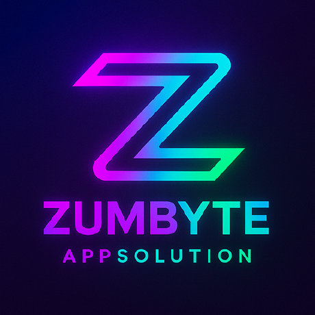
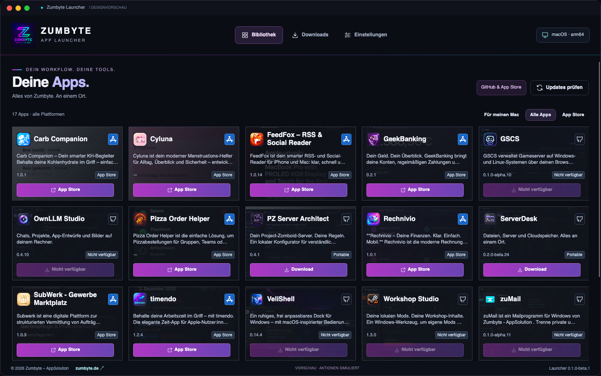
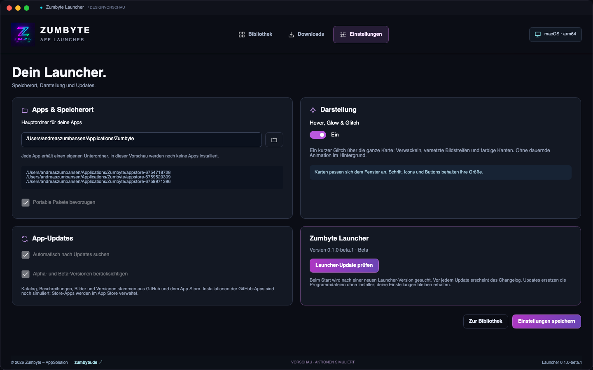
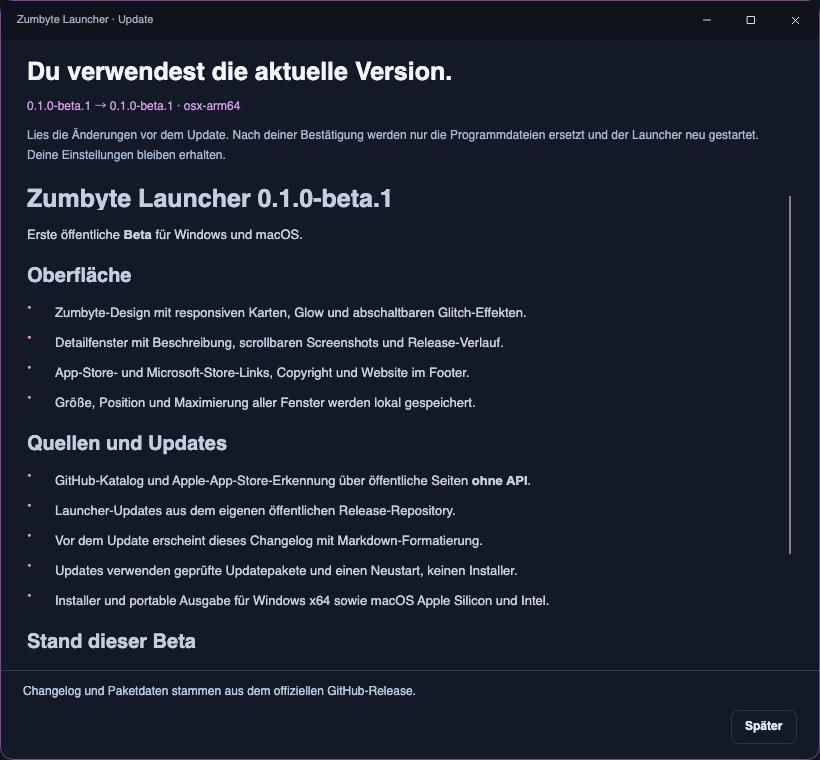

# Zumbyte Launcher

**Deine Zumbyte-Apps. An einem Ort.**

Zumbyte Launcher bündelt öffentliche Zumbyte-Projekte und Apps aus dem Apple App Store in einer Desktop-Oberfläche für Windows und macOS. Beschreibungen, Logos, Screenshots und Versionen stammen direkt aus den öffentlichen GitHub- und Store-Seiten – ohne API-Schlüssel.

## Downloads

Die [Releases](https://github.com/ZUMBYTE-AppSolution/launcher-releases/releases) enthalten:

| Plattform | Erstinstallation | Portable Ausgabe | Spätere Updates |
|---|---|---|---|
| Windows x64 | `win-beta-Setup.exe` | `win-beta-Portable.zip` | Vollständiges Updatepaket, ohne Installer |
| macOS Apple Silicon | `osx-arm64-beta-Setup.pkg` | `osx-arm64-beta-Portable.zip` | Vollständiges Updatepaket, ohne Installer |
| macOS Intel | `osx-x64-beta-Setup.pkg` | `osx-x64-beta-Portable.zip` | Vollständiges Updatepaket, ohne Installer |

Die .NET-Laufzeit ist enthalten. macOS setzt Version 14 oder neuer voraus. Windows setzt Windows 10 x64 oder neuer voraus. Mac-Ausgaben sind mit Developer ID signiert und von Apple notarisiert. Windows-Pakete sind derzeit unsigniert; Windows kann beim ersten Start einen Hinweis anzeigen.

Portable ZIP-Dateien vor dem Start vollständig entpacken. Unter macOS das App-Bundle auf einen beschreibbaren Datenträger kopieren; direkt aus einem schreibgeschützten Abbild sind Updates nicht möglich.

## Einblicke

## Updates

Beim Start und über **Einstellungen → Launcher-Update prüfen** liest die App eine öffentliche Update-Datei dieses Repositories. Das Changelog wird aus genau dem zugehörigen Release geladen und vor dem Update mit Markdown-Formatierung angezeigt. Erst ein Klick auf **Update laden und neu starten** startet den Download.

Der Launcher prüft Version, Betriebssystem, Architektur, Paketgröße und SHA256. Danach ersetzt der separate Updater die Programmdateien und startet die App neu. Der Erstinstallations-Installer wird dabei nicht erneut verwendet. Lokale Einstellungen bleiben erhalten und werden vor dem Wechsel gesichert. Fehlgeschlagene oder abgebrochene Downloads werden nicht angewendet.

Jeder Release enthält `CHANGELOG.md`, `SHA256SUMS.txt`, Plattform-Feeds und vollständige Updatepakete. Die Dateien unter `updates/` enthalten ausschließlich öffentliche Release-Metadaten.

## Stand der ersten Beta

Die Katalogerkennung, Bilder, Detailfenster, Store-Links und der Launcher-Updater sind integriert. **Download, Installation, Start und Deinstallation anderer GitHub-Apps sind weiterhin eine markierte Bedienvorschau.** Store-Apps werden vom jeweiligen Store verwaltet. Diese Beta meldet beim ersten Start keine Apps fälschlich als installiert.

Dieses Repository enthält Produktbeschreibung, Bilder, Changelogs und fertige Downloads. Der Anwendungsquellcode wird separat verwaltet.

[Website](https://zumbyte.de/) · [Fehler melden](https://github.com/ZUMBYTE-AppSolution/launcher-releases/issues)

© 2026 Zumbyte – AppSolution. Marken und App-Abbildungen gehören ihren jeweiligen Rechteinhabern. Lizenzhinweise der verwendeten Komponenten liegen den Paketen bei.
